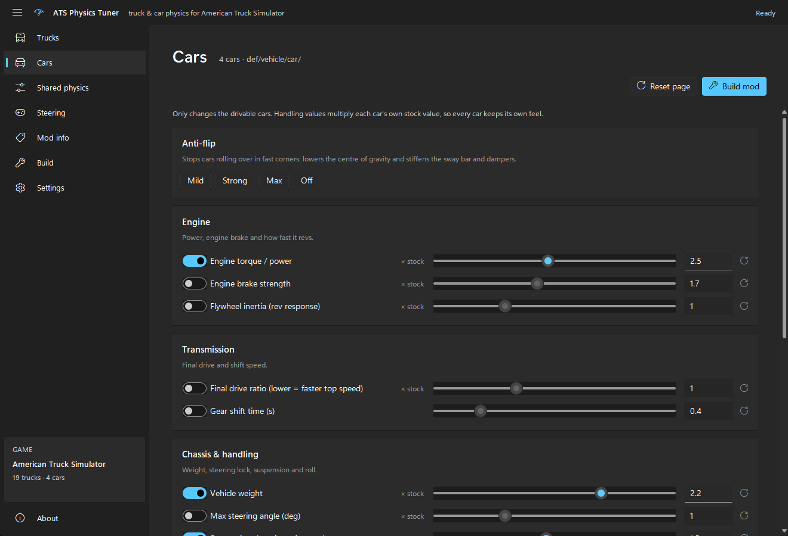
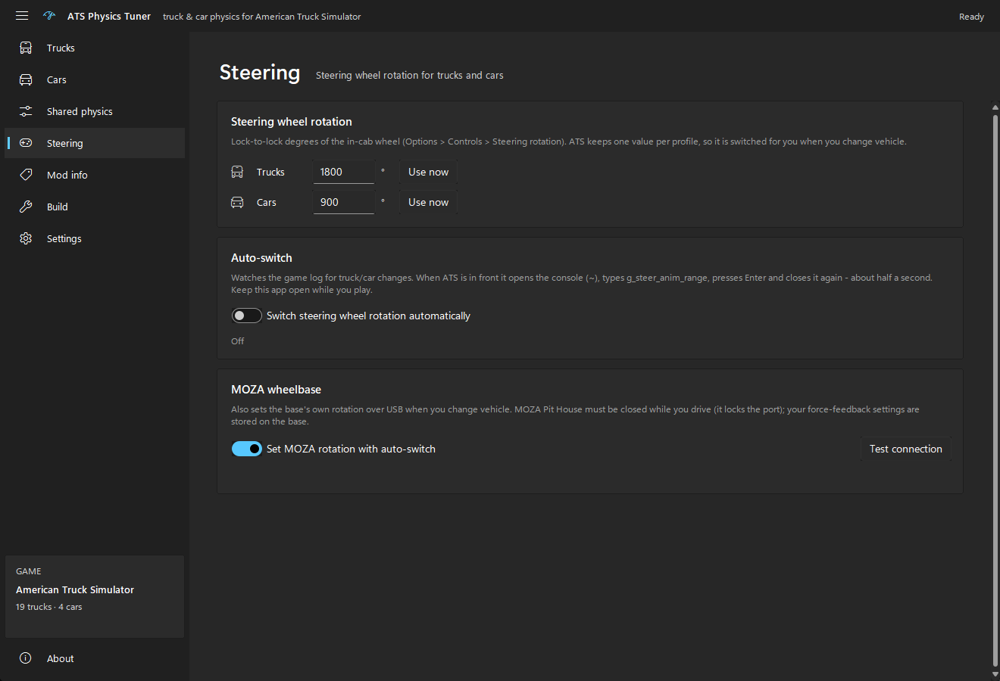

# ATS Physics Tuner

Tune **trucks and cars separately** in **American Truck Simulator**, and pack the result as a normal
`.scs` mod. The app reads your own ATS install, so you can change engine power, gearing, weight,
steering lock, suspension and roll for the trucks without touching the drivable Ford cars, and the
other way round. It can also switch your steering wheel rotation automatically when you change from
truck to car, including the rotation of a **MOZA** wheelbase.



> **No game files are included.** The tool reads the game you already own and only writes the
> definition files you change into one mod in your `mod` folder.

## Why

ATS has a single global physics file (`def/vehicle/physics.sii`) for every vehicle, so changing it
changes trucks and cars alike. This app tunes each vehicle's own engine, transmission and chassis
definitions instead, so trucks and cars really are separate.

## Features

**Trucks and Cars pages**
- **Engine**: torque/power, engine brake strength, flywheel inertia (how fast it revs).
- **Transmission**: final drive ratio (top speed vs. pulling power), gear shift time.
- **Chassis & handling**: weight, max steering angle, front and rear suspension damping, anti-roll
  (sway) bar, centre of gravity height, air resistance.
- **Front wheel angle per model**: set how far the tyres turn for each truck or car on its own
  (stock values are shown).
- **Apply to**: pick which models the settings change, for example only the W900 and the 389.
- Car values multiply each car's own stock value, so every car keeps its own feel. Truck files don't
  define the handling values, so for trucks those are written as exact values.

**Anti-flip (cars)**
- One click (**Mild**, **Strong** or **Max**) stops cars rolling over in fast corners. It lowers the
  centre of gravity and stiffens the sway bar and dampers.

**Shared physics**
- Every value of `physics.sii` (brakes, tyre grip and slip, self-centering, steering sensitivity,
  cab suspension…) with its stock value next to it. These apply to trucks **and** cars.

**Steering wheel rotation and auto-switch**
- Set a rotation for trucks (e.g. 1800°) and one for cars (e.g. 900°).
- ATS keeps one rotation per profile (`g_steer_anim_range`). With **Auto-switch** on, the app
  watches `game.log.txt` for the truck/car change. Once ATS is in front, it opens the console,
  types the command, presses Enter and closes the console again, which takes about half a second.
- **MOZA wheelbases**: the base's own rotation range is switched at the same time over USB, so the
  real wheel matches the truck or car.

**Mod info**
- Mod name, author, version (it can go up by itself on every build), a description and an icon
  (any picture, cropped to the Mod Manager's 276 × 162).

**Build**
- Writes `zz_truck_car_physics_tuner.scs` to `Documents\American Truck Simulator\mod`, with a status
  card, a summary of what's changed and a log.
- Export and import presets (`.json`) to share setups.



## Requirements

- Windows 10/11 and **American Truck Simulator** (Steam). Developed on 1.61.
- The Cars page needs the drivable cars (the Ford DLC). Trucks from the DLCs you own show up
  automatically.
- For auto-switch: the ATS console turned on (`uset g_console "1"` in `config.cfg`).
- For MOZA: **MOZA Pit House closed** while you drive, because it keeps the wheelbase's USB port to
  itself. Your force-feedback settings are stored on the base, so the game doesn't need Pit House.

## Using the app

1. Run `ATS Physics Tuner.exe` (keep it next to its `_internal` folder). From source, run
   `ats_physics_tuner.pyw` instead.
2. Check **Settings**: the ATS folder and the mod folder are found automatically on most machines.
3. On **Trucks** and **Cars**, switch on the settings you want and move the sliders. Settings that
   are switched off stay stock.
4. Optional: fill in **Mod info** (name, author, version, description, icon).
5. Click **Build mod**.
6. In ATS: **Mod Manager**, enable the mod and move it to the top. After every rebuild, restart the
   game or reload your profile.

For auto-switch: open **Steering**, set the truck and car rotation, and switch on **Auto-switch**
(and **MOZA**, if you have one). Leave the app open while you play.

## Building from source

```bat
build_exe.bat
```

This creates a private virtual env in `.build`, installs PyInstaller, sv-ttk and Pillow there (your
main Python isn't touched), and builds `dist/ATS Physics Tuner/ATS Physics Tuner.exe`.

To run from source you need Python 3.10+ with only the standard library. `sv-ttk` gives the
Windows 11 look and `Pillow` lets you use any picture as the mod icon. Both are optional.

> Build from a short path such as `C:\Projects\ATS Physics Tuner`. In very long paths, Windows
> can't load Pillow's DLL.

## Project layout

| Path | What it is |
|---|---|
| `ats_tuner_gui.py`, `fluent.py` | The desktop app (Tkinter, Windows 11 "Fluent" look) |
| `ats_physics_tuner.pyw` | Starts the app from source without a console window |
| `tuner_core.py` | Reads the vehicle definitions, patches the SII files, writes the `.scs` mod (manifest, description, icon) |
| `hashfs.py` | Reader for SCS HashFS v2 archives (`.scs`), with CityHash64 for the file paths |
| `autoswitch.py` | Watches `game.log.txt` for truck/car changes and types the console command |
| `moza.py` | Sets a MOZA wheelbase's rotation over its USB serial port (Win32, no extra packages) |
| `build_exe.py`, `build_exe.bat` | Packaging |
| `README.txt` | Short readme copied next to the exe |

### What the mod changes

| Page | Game files |
|---|---|
| Trucks | `def/vehicle/truck/<model>/{engine,transmission,chassis}/*.sii` |
| Cars | `def/vehicle/car/<model>/{engine,transmission,chassis}/*.sii` |
| Shared physics | `def/vehicle/physics.sii` |

Only files you actually change go into the mod. After a game update, click **Build mod** again so
the mod is made from the new game files.

## Notes and limitations

- The engine torque change is real, but the hp figure in the truck shop isn't updated.
- Truck handling values (steering lock, damping, sway bar, centre of gravity, air resistance) aren't
  set in the game's truck files. When you switch one on, the exact value is written into every
  selected truck chassis, so start with small changes.
- Steering wheel rotation can't be stored per vehicle in a mod. That's why auto-switch exists.
  Don't type in chat at the moment you change vehicle.
- MOZA support uses the serial protocol documented by
  [boxflat](https://github.com/Lawstorant/boxflat). It sets the base's rotation range (`limit` and
  `max-angle`) and nothing else.
- Single-player. In Convoy every player needs the same mod, and TruckersMP ignores it.

## Disclaimer

Fan-made tool, not affiliated with or endorsed by SCS Software or MOZA Racing. American Truck
Simulator is a trademark of SCS Software. Use it with a legally owned copy of the game and its DLCs.
Changing a wheelbase's settings is at your own risk.

## Author

Made by **wackyhacky**.
